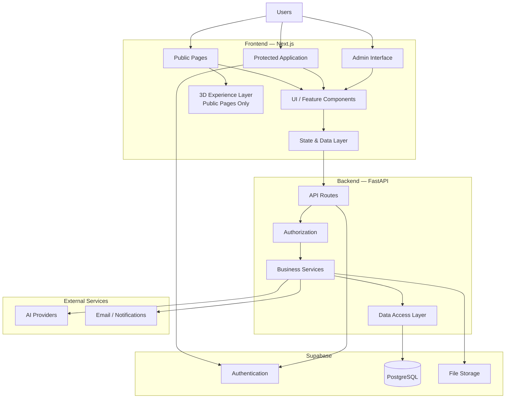
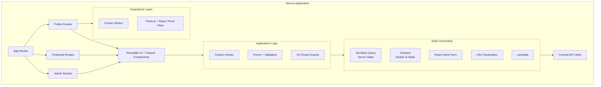
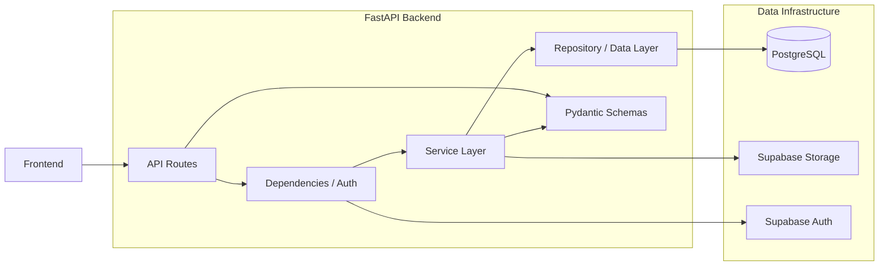
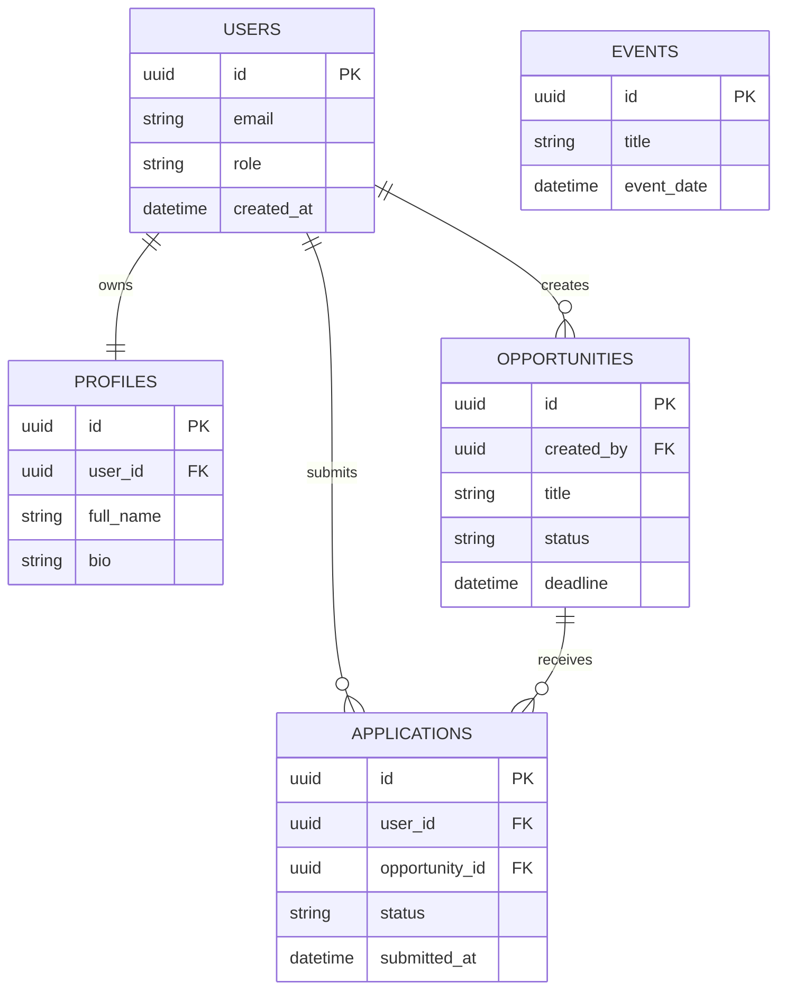
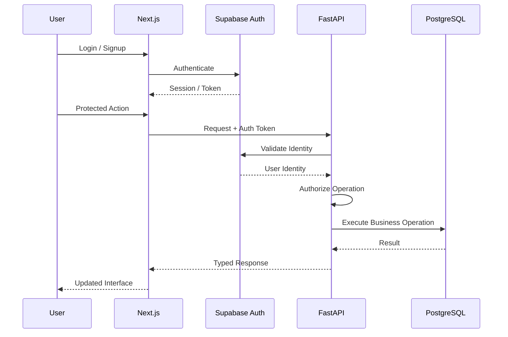
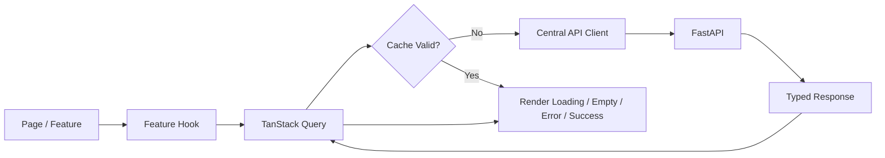
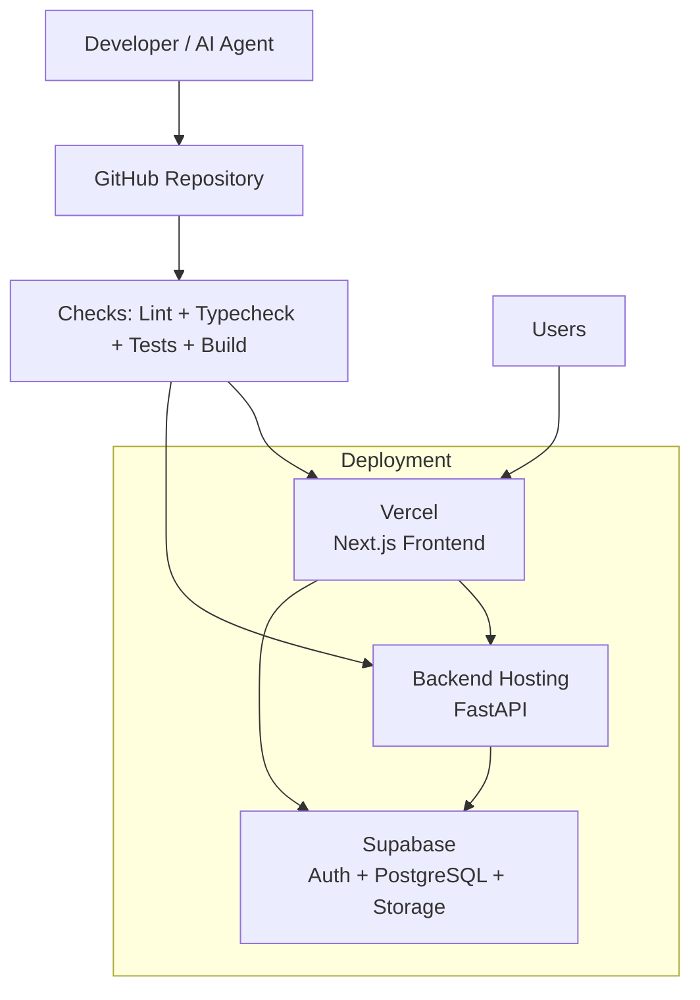

# ASCENT — Architecture

## 1. Architecture Goals

ASCENT follows a modular web architecture designed for:
- Clear separation of frontend, backend and data responsibilities
- AI-assisted development without architectural drift
- Secure authentication and authorization
- Independent feature development
- Progressive enhancement for public experiences
- Maintainability over unnecessary complexity

## 2. High-Level System Architecture

## 3. Frontend Architecture

### Responsibilities
The frontend is responsible for:
- User interface and interaction
- Route rendering and navigation
- Client-side form validation
- Server-state caching
- User experience feedback
- Public-page motion and optional 3D experiences

The frontend is **not** responsible for:
- Business authorization decisions
- Direct database access
- Sensitive business logic
- Final validation of protected operations

### 3D Boundary

3D/WebGL is restricted to selected public-facing experiences such as:
- Home / landing page
- Brand storytelling sections
- Selected public showcase pages

3D must not be required for:
- Authentication
- Dashboards
- Forms
- Applications
- Admin interfaces
- Core user workflows

All 3D experiences must:
- Be lazy loaded
- Have a meaningful 2D fallback
- Avoid blocking initial content
- Degrade gracefully on lower-powered devices

## 4. Backend Architecture

### Backend Layer Responsibilities

**API Routes**
- Receive HTTP requests
- Parse and validate input
- Apply dependencies
- Return responses
- Must remain thin

**Service Layer**
- Business logic
- Workflow orchestration
- Permission-aware operations
- Transaction boundaries where needed

**Repository/Data Layer**
- Database interaction
- Query abstraction
- No HTTP concerns

**Schemas**
- Request contracts
- Response contracts
- Validation and serialization

## 5. Core Data Architecture

Detailed schema definitions belong in implementation/database migrations. This diagram intentionally represents architectural relationships rather than every column.

## 6. Authentication and Request Flow

### Security Rule
Frontend checks improve UX. Backend authorization is the source of truth.

## 7. Frontend Data Flow

## 8. Deployment Architecture

## 9. Architectural Rules

1. Next.js App Router is mandatory.
2. TypeScript strict mode is mandatory.
3. Server Components are the default.
4. Client Components are used only when interaction requires them.
5. All API communication goes through a centralized API client.
6. TanStack Query owns server state.
7. Zustand is limited to global client UI state.
8. React Hook Form + Zod handles complex forms and client validation.
9. No direct database access from the frontend.
10. API routes remain thin.
11. Business logic belongs in backend services.
12. Database queries belong behind a data-access boundary.
13. Backend authorization is authoritative.
14. Every async UI handles loading, empty, error and success states.
15. Public 3D is progressive enhancement only.
16. Core workflows must work without WebGL.
17. Feature modules should own feature-specific logic.
18. Shared UI components must not contain domain business logic.
19. Avoid duplicate ownership of the same state.
20. Architecture changes require updating this document.
